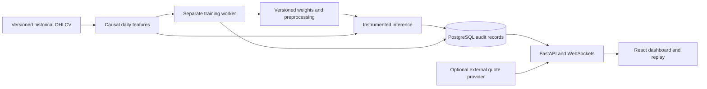

# NeuroStock architecture

NeuroStock runs entirely on the local machine. The frontend is React + TypeScript, Vite, Tailwind, Framer Motion, Lightweight Charts, and Recharts. FastAPI provides typed JSON endpoints and a persistent WebSocket event stream. A separate Python worker trains small, instrumented PyTorch recurrent networks. PostgreSQL stores the audit trail; a SQLite configuration supports a lightweight local development run.

## Processes and responsibilities

- `web`: Vite during development; nginx serves the production frontend and proxies `/api` and `/ws` in Compose.
- `api`: reads completed daily observations, validates model IDs, runs bounded inference, records immutable results, serves replay and evaluations, and streams persisted events. It never executes a training loop inside an HTTP request.
- `worker`: polls the database queue, claims a bounded training job, writes measured epoch statistics, saves a checkpoint, and registers the resulting model. The queue enforces one active training job.
- `db`: PostgreSQL with Alembic migrations. API and worker share the database and writable model volume. The read-only bundled models remain in the application image.
- `migrate`: a one-shot Compose service, completed before the API starts.

## Data boundary

Bundled data is a historical snapshot with source URLs, dates, hashes, and price conventions in `data/provenance.json`. Historical candles and replayed forecasts are explicitly labeled **Replay**. An external quote is displayed separately; it cannot silently change a model's input data or convert a daily model into an intraday model. Alpha Vantage credentials remain on the server. Provider failures are explicit and historical replay remains available.

The model computes causal features over completed daily observations. The latest quote is not an inference trigger. Target dates come from an exchange calendar, including holidays, rather than adding one calendar day. Exchange timestamps and UTC record creation timestamps have separate meanings.

## Forecast and replay contract

A forecast stores its creation time, target session, input cutoff, model version, data snapshot identifier, base close, return quantiles, and price quantiles. The associated snapshot preserves the observations used. Full telemetry is captured for user-requested predictions and includes the actual scaled and unscaled feature values, hidden states, LSTM cell states and gates, and output head values. Routine evaluation does not store full per-timestep gate arrays.

The UI advances a cursor over these saved arrays. It highlights the matching input candle and hidden-state heatmap column. Playback speed changes presentation time only. It cannot change the result, and no random activations are generated. The network diagram displays a subset of units with a count; the inspector gives numerical values and gate explanations.

Forecast and outcome rows are separate. Database triggers reject updates and deletion of forecasts, telemetry, snapshots, and outcomes. Historical target-session matches remain marked as retrospective replay. They are never reported as forward-running performance. Outcome reconciliation matches the instrument, data source, and exact target session.

## Event stream

Each event has a persisted identifier, type, timestamp, and payload. The client reconnects with its last event identifier and ignores duplicate IDs. The server replays retained events after that cursor. Its bounded retention prevents unbounded monitoring history; clients refresh authoritative HTTP state when a gap is reported. Training job histories also persist in the database, so reconnecting does not lose epoch progress.

## Bounded local operations

The API validates symbol and model registries, lookback, epochs, dataset size, and what-if perturbation ranges. Inference/evaluation has a concurrency limit and per-client rate limit. Training has a global active-job limit. Model weights use numeric NumPy archives rather than arbitrary Python pickle loading. Artifact paths originate from the server registry, not client paths. Cross-origin requests are restricted to configured origins. Compose publishes HTTP ports on loopback.

This is a single-user local research application. Multi-user authentication, per-user authorization, distributed training workers, cloud secret management, and public hosting hardening are outside this delivery. Do not expose the local unauthenticated API to the Internet.

## Important files

| Area | Files |
| --- | --- |
| Daily data and preprocessing | `backend/app/data.py`, `scripts/acquire_data.py` |
| Instrumented PyTorch cells | `backend/app/models.py` |
| Training, inference, evaluation | `backend/app/ml.py` |
| API, audit and event endpoints | `backend/app/main.py` |
| Database entities and invariants | `backend/app/db.py`, `backend/alembic/` |
| Separate training process | `backend/app/worker.py` |
| Optional quote provider | `backend/app/provider.py` |
| Dashboard and replay | `frontend/src/` |
| Local launcher | `scripts/dev.py` |
| Deployment | `compose.yaml`, `backend/Dockerfile`, `deploy/` |
